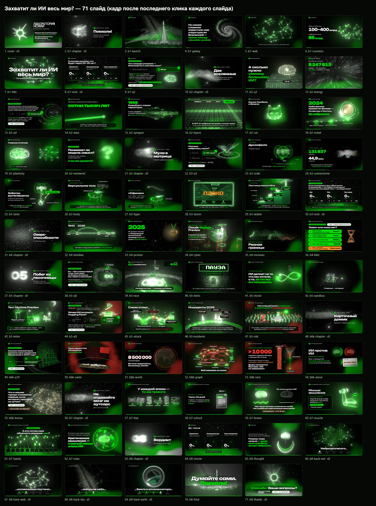

# Захватит ли ИИ весь мир? Путешествие во вселенную разума

Интерактивная сайт-презентация открытой лекции **лаборатории НСИИИ** (45 минут, 8 блоков, 12 интерактивов с залом).
3D-сцены на Three.js, плавные «космические» переходы между слайдами, общее облако из 65 тысяч частиц, которое перетекает
из формы в форму: след ракеты → Млечный Путь → космическая паутина → нейроны → мозг… Фирменный стиль — чёрный, белый,
зелёный и халфтон-точки из логотипа.

Сценарий лекции — [`tz.md`](tz.md). Спикеры: Маркин Евгений Игоревич (к.т.н., доцент кафедры «Программирование»)
и Зупарова Валентина Владимировна (старший преподаватель кафедры «Программирование»).



## Как показать

### Онлайн (GitHub Pages через GitHub Actions)
1. Загрузите репозиторий на GitHub (все файлы, включая скрытые папку `.github/` и `.nojekyll`), ветка `main`.
2. **Settings → Pages → Build and deployment → Source: GitHub Actions**.
3. Готово: workflow [`.github/workflows/pages.yml`](.github/workflows/pages.yml) при каждом `push` в `main` проверяет сайт
   (все пути существуют с точным регистром букв — `node tools/check-site.mjs`), собирает его в `_site` и публикует.
   Ход сборки — во вкладке **Actions**; запустить вручную — **Actions → «Публикация на GitHub Pages» → Run workflow**.
4. Презентация будет доступна по адресу `https://<ваш-логин>.github.io/<имя-репозитория>/`
   (окно спикера — `…/presenter.html`).

Сборщики (npm, Vite) не нужны: это статический сайт, все библиотеки и шрифты лежат в репозитории (`vendor/`, `assets/fonts/`).
Без Actions тоже можно: Source → **Deploy from a branch**, ветка `main`, папка `/ (root)` (тогда workflow можно удалить).

### Без интернета (на площадке)
Браузер не запускает модули с `file://`, поэтому нужен маленький локальный сервер:
- Windows: дважды щёлкните `start-local.bat` (нужен Node.js или Python);
- macOS/Linux: `./start-local.sh`;
- или вручную: `node tools/serve.mjs` / `python -m http.server 8000` → откройте `http://localhost:8000/`.

Рекомендуемый браузер — Chrome или Edge (нужен WebGL 2; без него презентация покажется как обычные слайды без 3D).
Перед лекцией откройте презентацию заранее: на стартовом экране загружаются первые 3D-сцены и код всех остальных —
после этого показ не зависит от Wi-Fi.

### Перед лекцией — чек-лист
1. Откройте презентацию за 5–10 минут до начала: на стартовом экране подгружаются 3D-сцены (полоса загрузки).
2. Проверьте кликер: «далее»/«назад», кнопку показа (`F5` — полный экран) и затемнение (`.`).
3. Если была репетиция — нажмите на стартовом экране «Сбросить голосования» (заодно обнулится таймер окна спикера).
4. Выберите тему под зал: тёмная — для затемнённого зала, светлая (`T`) — для светлого.
5. На ноутбуке откройте окно спикера (`S`), презентацию переведите на проектор и в полноэкранный режим.
6. Если графика подтормаживает — на стартовом экране выберите «Качество: среднее/низкое» (запоминается), а во время показа нажмите `Q` (разрешение 3D).
   Качество по умолчанию подбирается по видеокарте; разрешение 3D автоматически снижается, если кадры не успевают.

## Управление

| Действие | Клавиши |
|---|---|
| Далее | `PageDown`, `→`, `↓`, `Space`, `Enter`, клик мышью, свайп |
| Назад | `PageUp`, `←`, `↑`, `Backspace`, правый клик |
| Полный экран | `F5` — войти, `F` — включить/выключить (на стартовом экране — кнопка «Начать»). Чтобы выйти, удерживайте `Esc` |
| Чёрный / белый экран | `B` или `.` / `W` (любая клавиша — вернуть) |
| Список слайдов | `G` |
| Перейти к слайду | номер + `Enter` |
| Светлая / тёмная тема | `T` |
| Окно спикера | `S` |
| Разрешение графики | `Q` (если слабый компьютер тормозит) |
| Справка | `H` |

**Кликер.** Подходят обычные презентационные пульты (Logitech R400/R500/Spotlight и подобные): они посылают `PageDown`/`PageUp`,
кнопка «показ» — `F5` (включает полный экран и никогда не перезагружает страницу; случайный `Esc` с пульта из показа не выбивает), «чёрный экран» — `.`. Работает при любой раскладке.
Если нажать «далее» ещё во время загрузки, показ начнётся сразу, как только сцены будут готовы.

Внутри слайда клик кликера сначала проходит шаги (появление пунктов, ответы на вопросы, анимации), затем переходит дальше.
Адрес в строке браузера показывает слайд и шаг (`#12.3`), поэтому после перезагрузки можно продолжить с того же места
(на стартовом экране — кнопка «Продолжить со слайда …»).

**Окно спикера** (`S` или кнопка на стартовом экране) — заметки к каждому слайду, таймер с отставанием/опережением по плану лекции,
следующий слайд, крупные кнопки. Откройте его на ноутбуке, а презентацию — на проекторе в полноэкранном режиме (оба окна — в одном браузере).

**Голосования** (в начале, в блоке про муху и в финале): спикер считает поднятые руки — каждое нажатие на карточку
добавляет голос, кнопки «−1», «+1», «+10» — для исправлений и больших залов. Проценты считаются от общего числа голосов
по всем трём карточкам (в сумме 100 %), под процентом видно число голосов. Результаты сохраняются в браузере до финала,
где показывается «до/после». «Сбросить» срабатывает со второго нажатия.

**Светлая тема** (`T`) — для светлого зала: 3D-сцены перерисовываются «тушью по бумаге» в духе старинного астрономического атласа.

## Как править

- Спикеры на первом слайде — в `js/parts/intro.js` (массив SPEAKERS).
- Тексты слайдов и заметки спикера — в `js/parts/*.js` (по части на блок: `b1.js` … `b8.js`, блоки 2 и 5 разбиты на две части).
- Порядок частей и тайминг блоков — `js/config.js`.
- 3D-сцены — `js/visuals/<часть>/*.js`; общие — `js/visuals/core/`.
- Подробное описание API (как добавить слайд, вопрос, счётчик, голосование, свою 3D-сцену) — [`docs/AUTHORING.md`](docs/AUTHORING.md).
- Примеры всех компонентов: откройте `index.html?part=examples`. Отдельный блок: `index.html?part=b3`.

## Устройство

```
index.html, presenter.html   — презентация и окно спикера
css/                         — дизайн-система, компоненты, стили частей
js/core/                     — движок: рендер, пост-эффекты, халфтон-фон, GPU-частицы, камера, переходы, колода слайдов, управление
js/components/               — вопрос залу, счётчик, голосование, отсчёт, печатная машинка
js/visuals/                  — 3D-сцены
js/parts/                    — слайды по блокам лекции
assets/                      — логотип (SVG, PNG), шрифты, геоданные
vendor/                      — three.js r184, GSAP 3.14
tools/serve.mjs              — локальный сервер
tools/check-site.mjs         — проверка путей перед публикацией
.github/workflows/pages.yml  — публикация на GitHub Pages
```

## Лицензии и источники
- [three.js](https://threejs.org) — MIT; [GSAP](https://gsap.com) — Standard «No Charge» License.
- Шрифты Unbounded, Onest, JetBrains Mono, Press Start 2P — SIL Open Font License.
- Контуры суши, аэропорты, города — [Natural Earth](https://www.naturalearthdata.com) (public domain).
- Логотип — собственность лаборатории НСИИИ.
